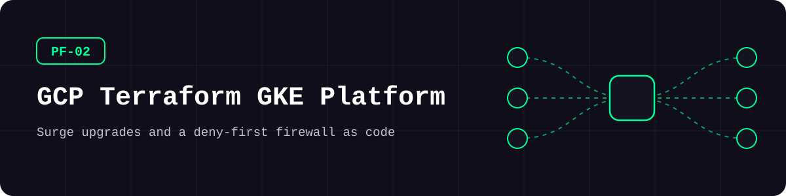
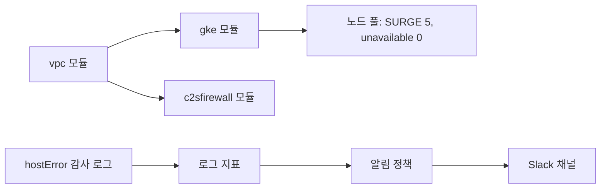
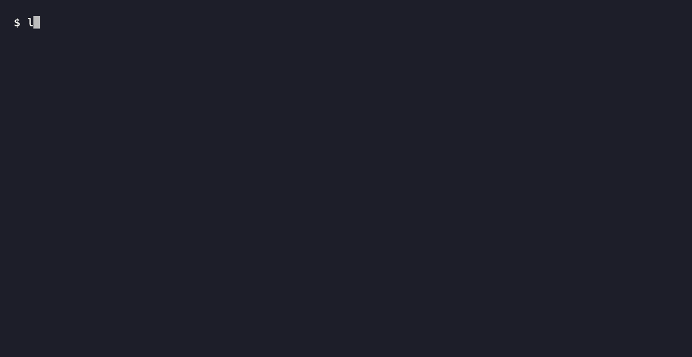

<picture>
  <source media="(prefers-color-scheme: dark)" srcset="docs/assets/banner-dark.svg">
  <source media="(prefers-color-scheme: light)" srcset="docs/assets/banner-light.svg">
  
</picture>

**용량을 줄이지 않고 GKE 노드 풀을 업그레이드하고, VPN에 필요한 포트만 여는 구성을 코드로 관리합니다.**

[](https://github.com/kimjhtlzk/pf-02-gcp-terraform-gke-platform/actions/workflows/ci.yml)    [](https://github.com/kimjhtlzk/pf-02-gcp-terraform-gke-platform/actions/workflows/ci.yml) [](LICENSE)

[English](README.md) | 한국어 · [포트폴리오](https://github.com/kimjhtlzk)

## 한눈에 보기

- **모듈 22개 · 완성된 예제 3개**
- **SURGE 업그레이드:** 노드 5개를 먼저 늘리고, 사용 불가 노드는 0개
- **기본 차단 방화벽:** 관리 포트는 VPN에서만 열고, 그 밖의 아웃바운드는 우선순위 65534에서 차단
- **강화한 GKE 기본값:** Workload Identity, GKE 메타데이터 서버, Secure Boot, 네트워크 정책
- 검증에 **자격증명이 필요 없습니다**

## 구조

<picture>
  <source media="(prefers-color-scheme: dark)" srcset="docs/assets/surge-dark.svg">
  <source media="(prefers-color-scheme: light)" srcset="docs/assets/surge-light.svg">
  
</picture>

<picture>
  <source media="(prefers-color-scheme: dark)" srcset="docs/assets/firewall-dark.svg">
  <source media="(prefers-color-scheme: light)" srcset="docs/assets/firewall-light.svg">
  
</picture>



## 데모



## 구성 요소

| 모듈 | 설명 | 주요 리소스 |
|---|---|---|
| `artifactregistry` | Artifact Registry 이미지 저장소 | `google_artifact_registry_repository` |
| `c2sfirewall` | VPN에서만 여는 관리 포트 + 아웃바운드 차단 | `google_compute_firewall` |
| `clb4pass` | 리전 패스스루 L4 로드밸런서 | `google_compute_forwarding_rule`, `google_compute_region_backend_service` |
| `clb4proxy` | 글로벌 TCP·SSL 프록시 로드밸런서 | `google_compute_target_tcp_proxy`, `google_compute_target_ssl_proxy` |
| `clb7` | 글로벌 HTTP·HTTPS 로드밸런서 | `google_compute_url_map`, `google_compute_target_https_proxy` |
| `clouddns` | 비공개 DNS 영역 | `google_dns_managed_zone` |
| `cloudnat` | Cloud Router와 NAT | `google_compute_router`, `google_compute_router_nat` |
| `firewall` | 규칙 맵으로 만드는 방화벽 규칙 | `google_compute_firewall` |
| `gce` | Compute Engine 인스턴스와 추가 디스크 | `google_compute_instance`, `google_compute_disk` |
| `gcediskasyncreplication` | 디스크 비동기 복제 | `google_compute_disk_async_replication` |
| `gcegroup` | 비관리형 인스턴스 그룹 | `google_compute_instance_group` |
| `gceresourcepolicy` | 스냅샷·배치 정책 | `google_compute_resource_policy` |
| `gke` | 업그레이드 설정을 갖춘 GKE 클러스터·노드 풀 | `google_container_cluster`, `google_container_node_pool` |
| `iam` | 프로젝트 IAM 역할 연결 | `google_project_iam_member` |
| `memorystorerediscluster` | Memorystore Redis 클러스터 | `google_redis_cluster` |
| `memorystoreredisinstance` | Memorystore Redis 인스턴스 | `google_redis_instance` |
| `publicip` | 리전·글로벌 고정 주소 | `google_compute_address`, `google_compute_global_address` |
| `serviceaccount` | 서비스 계정 | `google_service_account` |
| `stackdriver` | 로그 지표, 알림 정책, Slack 채널 | `google_logging_metric`, `google_monitoring_alert_policy` |
| `storagebucket` | 비공개·버전 관리 버킷 | `google_storage_bucket` |
| `vpc` | 보조 대역을 포함한 VPC·서브넷 | `google_compute_network`, `google_compute_subnetwork` |
| `vpcpeering` | VPC 피어링 | `google_compute_network_peering` |

## 레포 구조

```text
.
├── modules/                  # 22 modules, one version each
├── examples/
│   ├── gke-regional-cluster/ # surge upgrade settings
│   ├── baseline-firewall/    # VPN-only management ports
│   └── host-error-alerting/  # audit log to alert
└── docs/                     # architecture, decisions
```

## 빠른 시작

| 도구 | 버전 |
|---|---|
| Terraform | 1.9.8 |

검증에는 GCP 프로젝트가 필요 없습니다.

```bash
terraform -chdir=examples/gke-regional-cluster init -backend=false
terraform -chdir=examples/gke-regional-cluster validate
```

<details>
<summary>심화: 실제 프로젝트에 배포</summary>

예제의 프로젝트와 네트워크 값을 바꾸고 `gcloud auth application-default login`으로 인증한 뒤, `apply` 전에 `terraform plan`을 검토하세요. 알림 예제는 Slack 토큰을 `TF_VAR_slack_auth_token`에서 읽습니다.

</details>

## 사용 예시

**노드 업그레이드 중에도 용량 유지:**

```hcl
strategy        = ["SURGE"]
max_surge       = 5
max_unavailable = 0
```

**관리 포트는 VPN에만 열기:**

```hcl
module "baseline_firewall" {
  source = "../../modules/c2sfirewall"

  network           = module.network.network.id
  vpn_source_ranges = ["203.0.113.10/32"]
  management_ports  = ["22", "3389", "6379"]
}
```

**호스트 오류를 알림으로 바꾸기:**

```hcl
metrics = [
  {
    metric_name   = "compute_host_error"
    metric_filter = "protoPayload.methodName=\"compute.instances.hostError\""
  }
]
```

## 설계 판단

- **SURGE 업그레이드:** 노드를 먼저 늘리므로 업그레이드 중에도 용량이 줄지 않습니다.
- **명시적인 아웃바운드 차단:** GCP의 암묵 규칙은 모든 아웃바운드를 허용하기 때문입니다.
- **강화 설정은 모듈 안에:** 모든 클러스터가 같은 기준을 받습니다.
- **토큰은 민감 변수로만:** 코드에는 넣지 않습니다.

전체 기록: [docs/DECISIONS.md](docs/DECISIONS.md)

## GCP Terraform이 AWS보다 진입이 쉬운 이유

둘 다 실무에서 운영해 본 경험에서 정리했습니다.

- 프로바이더 문서가 명확하고 모듈 구조가 일관됩니다.
- 학습 곡선이 완만해서 IaC를 처음 시작하기에 좋습니다.
- 리소스가 `region`이나 `location`을 인자로 받아서 프로바이더 블록 하나로 모든 리전을 다룹니다. 같은 범위를 다루는 시리즈의 [AWS 레포](https://github.com/kimjhtlzk/pf-01-aws-terraform-multi-region)에는 프로바이더 별칭 16개가 필요합니다.

## 보안 고려 사항

- 노드 풀은 Secure Boot, 무결성 모니터링, GKE 메타데이터 서버를 사용합니다
- 클러스터는 클라이언트 인증서를 발급하지 않고, 버킷은 공개 접근 방지를 강제합니다
- Slack 토큰은 민감 변수입니다. 값은 모두 예시입니다: [SECURITY.md](SECURITY.md)
- CI에서 checkov와 gitleaks를 실행합니다. `#checkov:skip`마다 이유를 적었습니다

## 실무 배경

이 모듈들은 4개 클라우드에 걸친 플랫폼의 일부로, 라이브 게임 서비스의 GKE와 Compute Engine을 운영했습니다.

## 재구성하며 바꾼 점

| 유형 | 변경 |
|---|---|
| 구조 | 모듈당 한 버전, 표준 파일 구성, 상대 경로 소스, 예제 3개 |
| 민감정보 | 주석 제거, 이름·주소 교체, 하드코딩된 토큰 값 제거 |
| 수정 | 미사용 변수 제거, 소프트 삭제 활성화, VPN 대역·포트 변수화 |
| 테스트·CI | fmt, validate, tflint, checkov, terraform-docs, gitleaks |
| **데모용 추가** | 강화한 GKE·스토리지 기본값, 예제 루트 구성 3개 |

자세히: [docs/REFACTOR_NOTES.md](docs/REFACTOR_NOTES.md)

## 한계와 계획

- CI에서 예제는 검증만 하고 적용하지 않습니다.
- 로드밸런서 모듈의 출력에서 인증서 목록을 뺐습니다.
- 고객 제공 암호화 키와 버킷 접근 로그는 추가 의존성을 피하려고 이유를 적어 건너뛰었습니다.
- Soak 시간은 Blue-Green 업그레이드에만 적용되므로 SURGE 예제에서는 쓰이지 않습니다.

## 만든 사람

**김준현** · 퍼블릭 클라우드 인프라·보안 엔지니어

[포트폴리오](https://github.com/kimjhtlzk) · [LinkedIn](https://www.linkedin.com/in/ihanni/) · [블로그](https://hann-blume.tistory.com/)

## 시리즈의 다른 레포

| 번호 | 레포 | 보여 주는 것 |
|---|---|---|
| PF-01 | [pf-01-aws-terraform-multi-region](https://github.com/kimjhtlzk/pf-01-aws-terraform-multi-region) | `locals` 맵 하나로 만드는 16개 리전 AWS 플랫폼 |
| PF-02 | [pf-02-gcp-terraform-gke-platform](https://github.com/kimjhtlzk/pf-02-gcp-terraform-gke-platform) | SURGE 업그레이드와 기본 차단 방화벽을 갖춘 GKE 플랫폼 |
| PF-03 | [pf-03-tencent-terraform-audit-ready](https://github.com/kimjhtlzk/pf-03-tencent-terraform-audit-ready) | 감사 추적을 COS에 쌓는 Tencent Cloud IaC |
| PF-04 | [pf-04-aws-terragrunt-dry-iac](https://github.com/kimjhtlzk/pf-04-aws-terragrunt-dry-iac) | 실제 의존성 그래프를 가진 DRY Terragrunt 구조 |
| PF-05 | [pf-05-multicloud-asset-audit-automation](https://github.com/kimjhtlzk/pf-05-multicloud-asset-audit-automation) | 3개 클라우드 자산·감사 로그 수집 자동화 |
| PF-06 | [pf-06-aethercrew-ai-company](https://github.com/kimjhtlzk/pf-06-aethercrew-ai-company) | 안전장치를 갖춘 역할 기반 멀티 에이전트 회사 |
| PF-09 | [pf-09-aws-netops-firewall-automation](https://github.com/kimjhtlzk/pf-09-aws-netops-firewall-automation) | 여러 AWS 계정의 방화벽 변경을 확인·적용·검증 |
