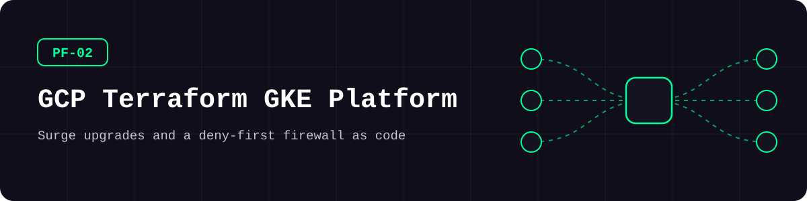
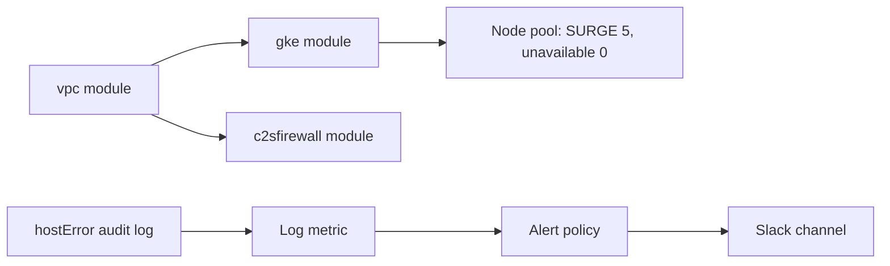

<picture>
  <source media="(prefers-color-scheme: dark)" srcset="docs/assets/banner-dark.svg">
  <source media="(prefers-color-scheme: light)" srcset="docs/assets/banner-light.svg">
  
</picture>

**Upgrade GKE node pools without losing capacity, and open only what a VPN needs, with both written as code.**

[](https://github.com/kimjhtlzk/pf-02-gcp-terraform-gke-platform/actions/workflows/ci.yml)    [](https://github.com/kimjhtlzk/pf-02-gcp-terraform-gke-platform/actions/workflows/ci.yml) [](LICENSE)

English | [한국어](README.ko.md) · [Portfolio](https://github.com/kimjhtlzk)

## At a glance

- **22 modules · 3 complete examples**
- **Surge upgrades:** 5 extra nodes first, 0 unavailable
- **Deny-first firewall:** management ports only from a VPN, other outbound traffic denied at priority 65534
- **Hardened GKE defaults:** workload identity, GKE metadata server, Secure Boot, network policy
- **No credentials** needed to validate

## Architecture

<picture>
  <source media="(prefers-color-scheme: dark)" srcset="docs/assets/surge-dark.svg">
  <source media="(prefers-color-scheme: light)" srcset="docs/assets/surge-light.svg">
  
</picture>

<picture>
  <source media="(prefers-color-scheme: dark)" srcset="docs/assets/firewall-dark.svg">
  <source media="(prefers-color-scheme: light)" srcset="docs/assets/firewall-light.svg">
  
</picture>



## Demo


## What's inside

| Module | Description | Main resources |
|---|---|---|
| `artifactregistry` | Container image repositories | `google_artifact_registry_repository` |
| `c2sfirewall` | VPN-only management ports with outbound deny | `google_compute_firewall` |
| `clb4pass` | Regional passthrough L4 load balancers | `google_compute_forwarding_rule`, `google_compute_region_backend_service` |
| `clb4proxy` | Global TCP and SSL proxy load balancers | `google_compute_target_tcp_proxy`, `google_compute_target_ssl_proxy` |
| `clb7` | Global HTTP and HTTPS load balancers | `google_compute_url_map`, `google_compute_target_https_proxy` |
| `clouddns` | Private DNS zones | `google_dns_managed_zone` |
| `cloudnat` | Cloud Router and NAT | `google_compute_router`, `google_compute_router_nat` |
| `firewall` | Firewall rules from a rule map | `google_compute_firewall` |
| `gce` | Compute Engine instances and extra disks | `google_compute_instance`, `google_compute_disk` |
| `gcediskasyncreplication` | Asynchronous disk replication | `google_compute_disk_async_replication` |
| `gcegroup` | Unmanaged instance groups | `google_compute_instance_group` |
| `gceresourcepolicy` | Snapshot and placement policies | `google_compute_resource_policy` |
| `gke` | GKE clusters and node pools with upgrade settings | `google_container_cluster`, `google_container_node_pool` |
| `iam` | Project IAM role bindings | `google_project_iam_member` |
| `memorystorerediscluster` | Memorystore Redis clusters | `google_redis_cluster` |
| `memorystoreredisinstance` | Memorystore Redis instances | `google_redis_instance` |
| `publicip` | Regional and global static addresses | `google_compute_address`, `google_compute_global_address` |
| `serviceaccount` | Service accounts | `google_service_account` |
| `stackdriver` | Log metrics, alert policies, Slack channels | `google_logging_metric`, `google_monitoring_alert_policy` |
| `storagebucket` | Private, versioned buckets | `google_storage_bucket` |
| `vpc` | VPC networks and subnets with secondary ranges | `google_compute_network`, `google_compute_subnetwork` |
| `vpcpeering` | VPC network peering | `google_compute_network_peering` |

## Repository structure

```text
.
├── modules/                  # 22 modules, one version each
├── examples/
│   ├── gke-regional-cluster/ # surge upgrade settings
│   ├── baseline-firewall/    # VPN-only management ports
│   └── host-error-alerting/  # audit log to alert
└── docs/                     # architecture, decisions
```

## Quick start

| Tool | Version |
|---|---|
| Terraform | 1.9.8 |

No GCP project is needed to validate.

```bash
terraform -chdir=examples/gke-regional-cluster init -backend=false
terraform -chdir=examples/gke-regional-cluster validate
```

<details>
<summary>Advanced: deploy to a real project</summary>

Set your project and networks in the example, authenticate with `gcloud auth application-default login`, then review `terraform plan` before `apply`. The alerting example reads its Slack token from `TF_VAR_slack_auth_token`.

</details>

## Usage examples

**Keep capacity during a node upgrade:**

```hcl
strategy        = ["SURGE"]
max_surge       = 5
max_unavailable = 0
```

**Open management ports to the VPN only:**

```hcl
module "baseline_firewall" {
  source = "../../modules/c2sfirewall"

  network           = module.network.network.id
  vpn_source_ranges = ["203.0.113.10/32"]
  management_ports  = ["22", "3389", "6379"]
}
```

**Turn a host error into an alert:**

```hcl
metrics = [
  {
    metric_name   = "compute_host_error"
    metric_filter = "protoPayload.methodName=\"compute.instances.hostError\""
  }
]
```

## Design decisions

- **Surge over in-place upgrades**, because adding nodes first keeps capacity during the upgrade.
- **An explicit outbound deny**, because GCP's implied rule allows all outbound traffic.
- **Hardening in the module**, so that every cluster gets it.
- **Tokens only as sensitive variables**, never in code.

Full records: [docs/DECISIONS.md](docs/DECISIONS.md)

## Why GCP Terraform is an easier start than AWS

From running both in production:

- The provider documentation is clear, and module structures stay consistent.
- The learning curve is gentle, which makes it a good first cloud for infrastructure as code.
- Resources take `region` or `location` as an argument, so one provider block covers every region. The [AWS repository](https://github.com/kimjhtlzk/pf-01-aws-terraform-multi-region) in this series needs 16 provider aliases for the same reach.

## Security considerations

- Node pools use Secure Boot, integrity monitoring, and the GKE metadata server
- Clusters issue no client certificates, and buckets enforce public access prevention
- The Slack token is a sensitive variable. Placeholders only: see [SECURITY.md](SECURITY.md)
- CI runs checkov and gitleaks. Each `#checkov:skip` states its reason

## Real-world context

These modules ran GKE and Compute Engine for live game services, as part of a platform across four cloud providers.

## What changed in this refactor

| Type | Change |
|---|---|
| Structure | One version per module, standard files, relative sources, three examples |
| Sensitive data | Comments removed, names and addresses replaced, a hardcoded token value removed |
| Fixes | Unused variables removed, soft delete turned on, VPN ranges and ports made into variables |
| Tests and CI | fmt, validate, tflint, checkov, terraform-docs, gitleaks |
| **New for the demo** | Hardened GKE and storage defaults, and the three example root configurations |

Details: [docs/REFACTOR_NOTES.md](docs/REFACTOR_NOTES.md)

## Limitations and roadmap

- Examples are validated, not applied, in CI.
- The load balancer modules no longer print certificate lists in their outputs.
- Customer-supplied encryption keys and bucket access logs are skipped with reasons, to keep the examples free of extra dependencies.
- Soak time applies only to blue-green upgrades, so the surge example does not use it.

## Author

**Kim JunHyun** · Public Cloud Infrastructure & Security Engineer

[Portfolio](https://github.com/kimjhtlzk) · [LinkedIn](https://www.linkedin.com/in/ihanni/) · [Blog](https://hann-blume.tistory.com/)

## More in this series

| No. | Repository | What it shows |
|---|---|---|
| PF-01 | [pf-01-aws-terraform-multi-region](https://github.com/kimjhtlzk/pf-01-aws-terraform-multi-region) | 16-region AWS platform from one `locals` map |
| PF-02 | [pf-02-gcp-terraform-gke-platform](https://github.com/kimjhtlzk/pf-02-gcp-terraform-gke-platform) | GKE platform with surge upgrades and a deny-first firewall |
| PF-03 | [pf-03-tencent-terraform-audit-ready](https://github.com/kimjhtlzk/pf-03-tencent-terraform-audit-ready) | Tencent Cloud IaC with audit trails stored in COS |
| PF-04 | [pf-04-aws-terragrunt-dry-iac](https://github.com/kimjhtlzk/pf-04-aws-terragrunt-dry-iac) | DRY Terragrunt layout with a real dependency graph |
| PF-05 | [pf-05-multicloud-asset-audit-automation](https://github.com/kimjhtlzk/pf-05-multicloud-asset-audit-automation) | Asset and audit collection across three clouds |
| PF-06 | [pf-06-aethercrew-ai-company](https://github.com/kimjhtlzk/pf-06-aethercrew-ai-company) | Role-based multi-agent company with safety controls |
| PF-09 | [pf-09-aws-netops-firewall-automation](https://github.com/kimjhtlzk/pf-09-aws-netops-firewall-automation) | Check, apply, and verify firewall changes across AWS accounts |
